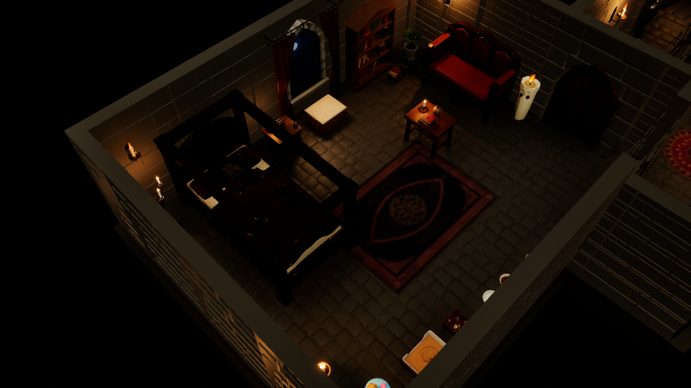
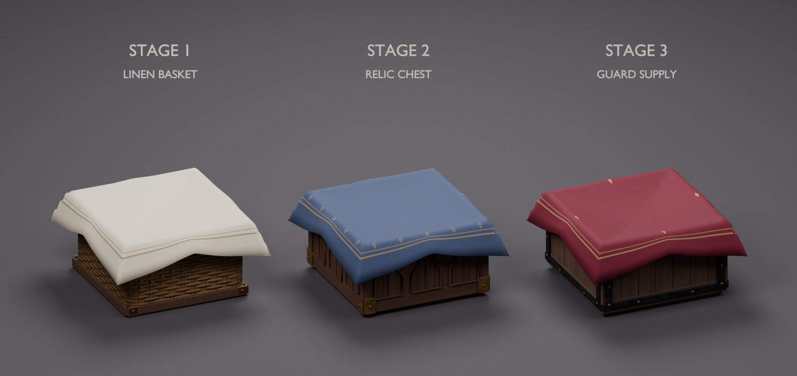
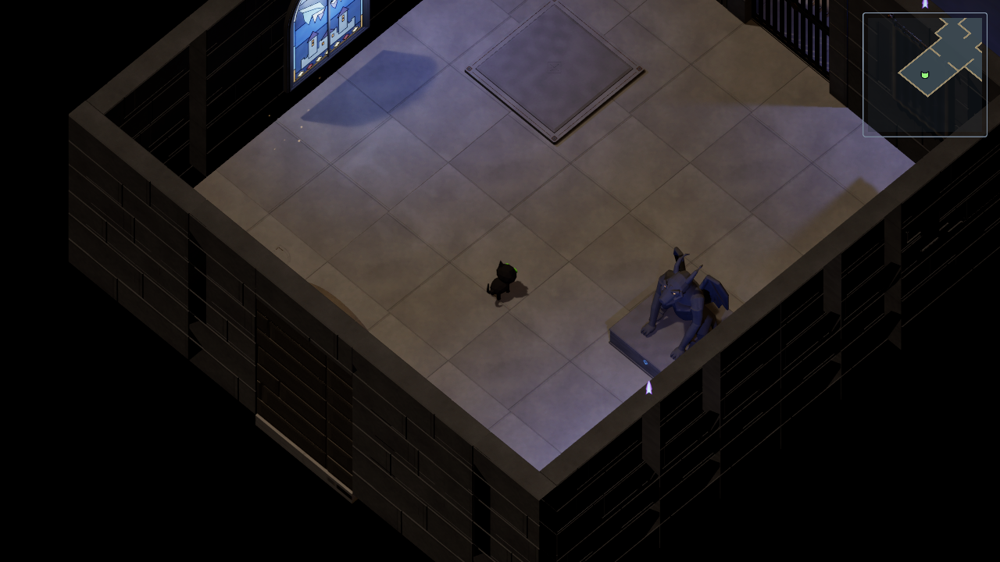
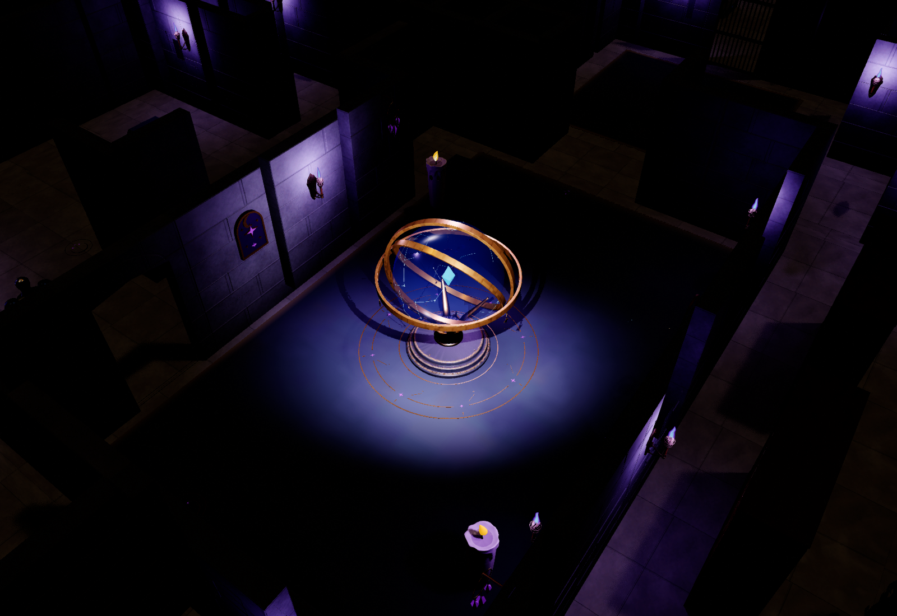
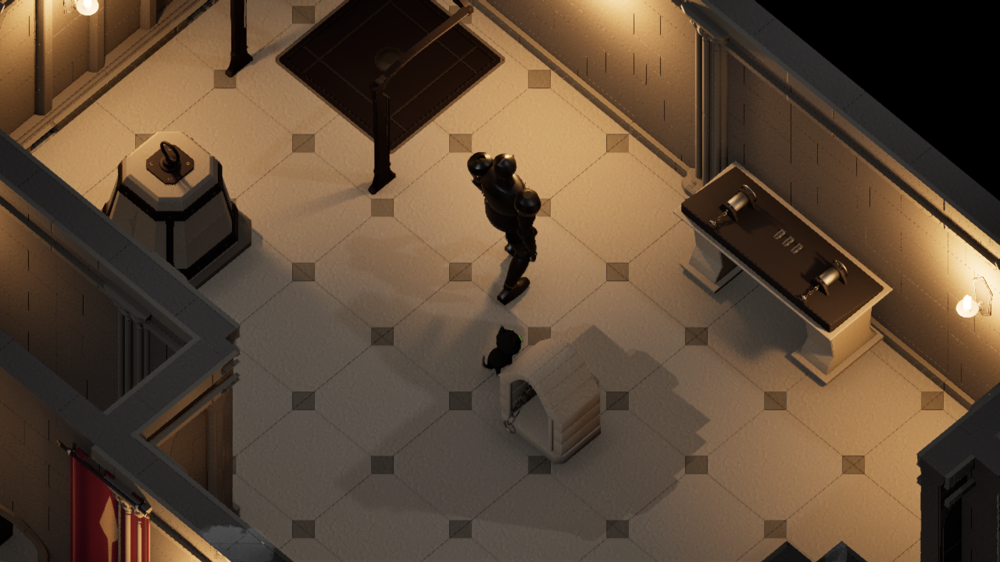
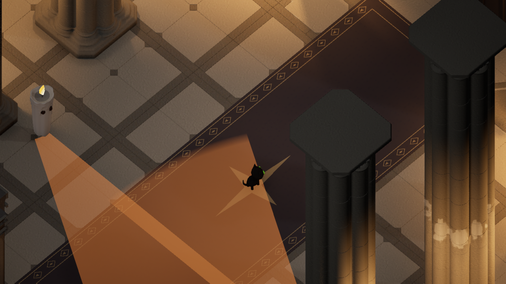
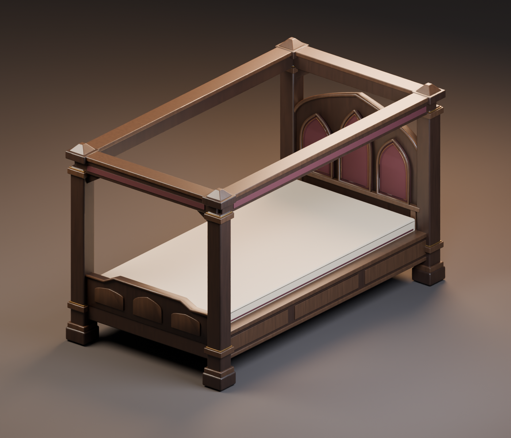

# Catrun Blender 디자인 지침서

《마왕님, 고양이가 도망갑니다》 · 2026-11-25 갱신 (최초 2026-11-24) · 구역별 제작 기준

이 문서는 새 에셋을 Blender에 제작시키거나 기존 에셋을 수정시킬 때 전달하는 지침이다. 현재 원본·프로젝트 파일과 기존 화면에서 읽어 낸 스타일을 정리했으며, 기존 에셋을 이 문서에 맞춰 일괄 변경하라는 지시는 아니다.

**신규 제작 원칙 (2026-11-25 사용자 지시): 새로 필요한 에셋은 그 용도와 구역에 맞춰 새로 제작한다. 기존 에셋 재사용을 기본안이나 대안으로 제안하지 않는다. 추가 제작이 있을지 없을지는 정해지지 않았으므로 제작이 끝났다고 단정하지 않는다.** 구체적인 적용은 4절에 있다.

**핵심 방향: 귀여운 검은 고양이가, 오래되었지만 생활의 흔적이 남은 묵직한 고딕 성을 밤에 탈출한다. 단순하고 읽기 쉬운 캐릭터 형태에, 목재·돌·직물·금속의 설득력 있는 재질을 결합한다.**

## 1. 무엇을 근거로 만들었는가

### 2026-11-25 갱신

- 11월 24일 조사 이후 추가된 Stage3, 승강기, 은신 바구니 3종, 천구의와 Stage2 수정본을 반영했다. 현재 `CastleKit`의 파일은 blend 289개, FBX 363개, PNG 3,745개다. 백업·QA·중복 사본이 포함된 파일 수이며 에셋 수가 아니다.
- Stage3 Production02·Mechanisms03, 승강기, 바구니, 천구의 매니페스트가 가리키는 파일의 존재를 확인했다. 자동 대조한 SHA-256 303건이 일치했다(바구니 매니페스트는 해시 미대조).
- 2절의 "게임 맵이 참조하는 버전"은 저장된 `.umap` 안의 패키지 경로를 읽은 결과다. 화면에 보이는지, 런타임에 교체되는지까지 뜻하지 않는다.
- 수치는 납품 매니페스트와 제작·검수 기록에서 옮겼다. 이번 갱신에서 Blender로 파일을 열거나 Unreal을 실행하지 않았다.

### 2026-11-24 최초 조사

아래와 연결된 목록은 당시 기록이다. 이후 추가분은 들어 있지 않다.

- `C:/Users/whghk/Desktop/CastleKit` 전체 파일 목록을 조사했다. 전체 blend 101개 중 백업 폴더를 제외한 **85개를 Blender 백그라운드에서 실제로 열어** 오브젝트·재질·UV·이미지 연결·액션 목록을 확인했다. 열기 오류는 없었다.
- 같은 기준에서 FBX 141개, PNG 278개가 존재한다. 파일 수이며 고유 에셋 수가 아니다. 이번에 FBX 전체를 재임포트한 것은 아니다.
- 현재 작업 폴더의 `Content/Characters`, `Content/Environment` 패키지 이름을 대조하고, 기획 원문과 개별 에셋 제작 기록을 읽었다.
- 기존 Unreal 화면과 원본 침대 이미지를 직접 확인했다. **이미지는 과거 저장 화면이며 이번에 현재 맵을 실행한 결과는 아니다.** 실시간 Blender MCP는 연결되지 않아 설치된 Blender 5.2.1로 원본을 읽기만 했다.
- `관찰`은 이번에 읽은 파일·화면의 특징, `제작 기록`은 원본에 동봉된 설명, `지침`은 그에 맞춰 앞으로 적용할 제작 기준이다. 최종 화면·게임 성능까지 검증됐다는 의미로 사용하지 않는다.

전체 파일 목록과 조사 한계: [에셋 조사 기록](BlenderReference/AssetSurvey_2026-11-24.md) · [85개 blend 상세 목록 CSV](BlenderReference/AssetInventory_2026-11-24.csv)

## 2. 현재 에셋의 구성과 기준작

원본 경로는 아래 표에서 `CastleKit/` 이하를 생략했다. 최종본 선택은 파일 이름만으로 결정하지 말고 작업 대상과 프로젝트 참조를 함께 확인한다.

| 분류 | 확인한 주요 원본 | 디자인에서 가져올 기준 |
|---|---|---|
| 주인공 | `BlackCat/Final`, `BlackCat/StairDown`, `BlackCat/PortalCinematic` | 검은 몸, 큰 초록 눈, 붉은 목걸이, 황동 방울. 동작 수정과 외형 수정의 경계 |
| 하수인·마왕 | `CandleMonster`, `LivingArmor/Final`, `DemonKing` | 크림색 밀랍·간결한 얼굴, 강철 판금과 황동 부속, 잠옷과 촉수형 얼굴의 마왕 |
| 하수인 Stage2형 | `Stage2/Characters` | 은색 강철·남청 흉갑과 어깨·좁은 황동 테두리 / 옅은 회보라 밀랍. 원형의 리그·비율 유지 |
| 하수인 Stage3형 | `Stage3/Production02_20261125/Characters` | 먹철 갑옷, 조정된 밀랍색. 원형의 메시·UV·가중치·액션 유지 |
| 성의 기본 골조 | 최상위 벽·바닥·문틀, `BedroomDoor`, `GothicWindow`, `Stage1/CatHoleTrim` | 큰 석조 덩어리, 아치, 목재 문과 철제 보강, 고양이용 통로 |
| 침실·응접 가구 | `DemonBed`, `BeddingSet`, `BedsideTable`, `Sofa`, `SofaGothic`, `SofaCushion`, `SmallTable`, `SideTable` | 어두운 목재, 버건디 천, 얇은 황동 테두리, 단정한 고딕 몰딩 |
| 연회장 | `BanquetTable`, `BanquetChair`, `DemonKingChair`, `Sideboard`, `TableDressing` | 긴 목재 가구, 천 덮개, 무게 있는 의자와 제한된 장식 |
| 주방·창고 | `KitchenCounter`, `KitchenHearth`, `KitchenShelf`, `PrepTable`, `HangingRack`, `Barrel`, `CrateA`, `GrainSack`, `StorageShelf`, `SupplyCrates` | 기능이 보이는 구조, 판재·돌·철·마대의 차이, 사용 흔적 |
| 생활·고양이 소품 | `CatTower`, `CatFoodBag`, `CatFoodBowl`, `CatWaterBowl`, `CatLitterBox`, `CatToyBox` | 리넨·도자기·목재. 성에 고양이가 실제로 살고 있다는 단서 |
| 은신 바구니 3종 | `HideBasket/Variants20261125` | Stage1·튜토리얼 라탄+아이보리 린넨 / Stage2 호두나무 유물함+청회색 천 / Stage3 흑철 띠 보급함+버건디 천 |
| 장식·직물 | 여러 `Rug*`, `CurtainSet`, `PortraitSmall`, `StudyProps`, `TapestryCastle`, `TapestryMoonGarden`, `TapestryArmorGuardian` | 버건디·남청 직물, 바랜 문양, 월넛 봉과 황동 부속, 그림을 품은 직조물 |
| 등기구·기타 | `WallSconce`, `TorchWall`, `FloorCandelabrum`, `TableCandle`, `Fireplace`, `LogBasket`, `IndoorPlanter`, `StonePlanter`, `StoneBench` | 작은 불꽃, 어두운 금속, 밀랍·장작·돌의 재질 분리 |
| Stage2 건축 | `Stage2/Walls`, `Floors`, `CatHoleTrim`, `Doors/ArchedIronDoor`, `Doors/RisingGate`, `PortalFrame` | 회색 절단석, 밝은 판석, 흑철, 매립 황동 장치와 제한된 룬 |
| Stage2 소품·퍼즐 | `Stage2/Props`의 가고일·누름판·양면 책장·스테인드글라스·성좌 태피스트리·성 역사 태피스트리·별자리판·마도석·러너 | 차분한 회색과 남청, 학술·마도 문양, 명확한 퍼즐 실루엣 |
| Stage2→3 승강기 | `Stage2To3_Elevator/Production01_20261125` (`SM_E23_` 35종) | 목재 판재 객실, 흑철 보강, 도르래·밧줄, 회색 석재 승강장 |
| Stage3 건축·바닥·문 | `Stage3/Production02_20261125`의 `Architecture`, `Floors`, `ArchitectureDoors`, `Doors` | 회갈색 세로 분할 석벽, 다발 기둥, 팔각석 바닥, 흑철 성문 |
| Stage3 소품·등기구 | 같은 폴더의 `Props`, `Decor` | 무기·방패·갑주 거치대, 작전대, 정비대, 군기, 첨두형 벽등 |
| Stage3 퍼즐 장치 | `Stage3/Mechanisms03_20261125` (24종), `Production02_20261125/Puzzles`의 해제기 | 중량추, 도킹 프레임, 실제로 맞물린 사슬, 철창 잠금쇠 |
| Stage3 성문 러그 | `Stage3/Rugs04_20261125` | 300×900×0.6cm, 탁한 자회색 직물과 황동색 실 문장 |

**주의할 버전:** Stage2의 `Backups` 안 에메랄드 벽·문은 현행 스타일 기준에서 제외한다. 제작 기록상 회색 마도 회랑으로 교체됐다. 고양이와 갑옷의 구형 파일·리그를 `Final`과 섞지 않는다. 최상위 러그와 `RugLarge` 하위 원본도 별도 버전으로 취급한다.

### 현행본과 구버전

| 대상 | 현행 기준 | 기준으로 쓰지 않을 것 |
|---|---|---|
| Stage3 환경 | `Production02_20261125` + `Mechanisms03_20261125` + `Rugs04_20261125` | `Sample01_20261124` (사용자 반려 시안) |
| Stage3 석상 | `Puzzles/D01_ReferenceRebuild` | `Puzzles/SM_S3_GuardianStatue` (사용자 반려본) |
| 은신 바구니 | `HideBasket/Variants20261125` | `HideBasket` 최상위의 65×80×45cm 구형 |
| 큰 러그 | `RugLarge` | 최상위 `SM_Rug_Large*` |
| 갑옷 | `LivingArmor/Final` | `LivingArmor/Backup_BeforeDoorFit_20261006` |
| Stage2 갑옷의 엔진 재임포트 | `SK_LivingArmor_Stage2_A_UE.fbx` | 접미사 없는 일반 FBX |
| Stage2 천구의 형태 | 아래 표의 B안 | `Stage2/Props/ArmillarySphere`는 이전 안 |

### 게임 맵이 참조하는 버전이 납품 폴더와 다른 것

다음은 `CastleKit`이 아니라 게임 쪽에 최신본이 있다. `CastleKit` 파일을 다시 임포트하면 이전 상태로 돌아갈 수 있다.

| 대상 | 게임 폴더 (`/Game/Environment/` 이하) | Blender 원본 위치 |
|---|---|---|
| Stage2 천구의 B안 | `Stage2/ArmillaryB_20261125` | `C:/Users/whghk/.codex/workspaces/Stage2ArmillaryB_20261125_01a20e2d/` |
| Stage2 가고일·누름판·러그 3종 | `Stage2/Refinement_20261125` | `C:/Users/whghk/.codex/workspaces/Stage2AssetReview_20261125_01a20e2d/Production/`. 러그는 `Textiles/EngineReadyFinal`만 최종본 |
| Stage2 마법회랑 장식 5종 | `Stage2/MagicCorridor_20261125` | `Saved/Stage2MagicCorridor_20261125/Source/` |
| Stage3 경사 석재 전시대 | `Stage3/GothicRevision_20261125/Meshes` | 이번 확인에서 blend를 찾지 못함 |
| Stage3 절단 바닥·벽 15종 | `Stage3/FinalGuard/Closures` | 원판 절단본 |

`.codex` 작업 폴더와 `Saved`는 Git에 포함되지 않는다. 수정 작업 전에 원본 파일이 남아 있는지 먼저 확인한다.

Stage3 맵에는 동상과 중량추가 함께 들어 있다. 동상·발판 액터는 퍼즐 판정용으로 유지하고 중량추·도킹 장치를 시각 요소로 붙인 구성이므로, 어느 한쪽을 미사용으로 보고 지우지 않는다.

일부 `CastleKit` README의 "Unreal 미임포트"는 작성 당시 문구다. 이름으로 대조하면 납품 메시 대부분이 게임에 있다. 게임 적용 상태는 `Docs/Reviews`의 최신 기록을 따른다.

## 3. 전체 분위기와 구역별 차이

### 공통 인상

성은 어둡고 크지만 사람이 생활하는 물건이 있다. 침구, 식탁, 책, 커튼, 고양이 그릇이 공간을 설명한다. 낡음은 표면의 사용감으로 표현하고, 모든 물건을 폐허나 고문 도구처럼 만들지 않는다.

고딕은 첨두아치·세로로 긴 패널·몰딩·문양의 반복에서 읽히게 한다. 기존 둥근 포탈 아치처럼 기능과 원본에 따른 예외를 허용한다. 모든 에셋에 뾰족한 끝이나 룬을 붙이지 않는다.

가장 중요한 대비는 **작고 표정이 잘 읽히는 고양이 ↔ 크고 무게 있는 성과 가구**다. 배경 전체를 고양이처럼 둥글게 만들거나, 고양이를 사실적인 털·비율로 바꾸지 않는다.

### 튜토리얼·Stage1 — 따뜻한 생활 공간

월넛 갈색, 버건디, 회갈색 돌, 바랜 황동, 크림색 천이 기본이다. 촛불의 따뜻한 국소광 속에서 목재와 직물이 살아난다. 색은 짙고 차분하게 유지하되, 따뜻한 분위기를 만들려고 모든 BaseColor를 주황색으로 물들이지 않는다.

*기존 저장 화면: 침실의 목재 가구·버건디 직물·촛불·회색 돌의 조합. 현재 조명값을 확정하는 자료는 아니다.*

### 은신 바구니로 보는 구역 차이

같은 기능이라도 구역마다 구조·재질·색이 다르다.

*Blender 렌더: 왼쪽부터 Stage1 라탄과 린넨, Stage2 유물함, Stage3 보급함. 게임 화면이 아니다.*

### Stage2 — 차가운 회색 마도 회랑

약한 푸른 기의 회색 벽, 그보다 밝은 판석 바닥, 흑철 문, 남청 직물, 작게 들어간 황동을 기준으로 한다. 마법은 작은 룬·별자리·유리·장치로 드러낸다. 벽 전체의 강한 녹색이나 넓은 네온 발광을 기본값으로 삼지 않는다.

*11월 23일 저장 화면: 가고일의 덩어리, 평평한 발판, 밝은 석재 바닥과 푸른 포인트. 이후의 수정은 반영되지 않았다. 화면의 푸른빛을 석재 고유색으로 그대로 복제하지 않는다.*

11월 25일에 중앙 구조물이 천구의 B안으로 바뀌고 라일락·보라 계열 조명과 마법회랑 장식이 추가됐다. 보라는 조명과 작은 발광에서 나온다. 벽·바닥 석재 BaseColor를 보라로 바꾸지 않는다. 장식은 황동·보라색 석판·라일락 발광의 공통 재질을 쓴다.

*11월 25일 저장 화면: 천구의 B안과 마법회랑 조명.*

### Stage2→3 승강기 — 실용적인 목재 화물 승강기

붉은 기가 도는 목재 판재와 가로 보강목, 흑철 모서리, 밧줄·도르래·사슬이 구조로 읽힌다. 승강장과 창고는 회색 절단석이다. 마도 문양이나 군사 문장을 장식으로 추가하지 않는다. 객실 바닥 기준은 220×200cm, 당김 고리의 잡는 높이는 130cm다.

### Stage3 — 고딕 군사 경비시설

회백석의 엄숙한 경비시설이며 마왕성의 최종 관문이다. 군사적 질서, 수직성, 거대한 성문으로 위압감을 만든다. 왕실·성당·종교 설정, 투박한 브루탈리즘, 스팀펑크, 과도한 공포와 고어는 제외한다.

- **벽**은 세로 분할 석재와 얕은 첨두아치 음각, **기둥**은 다발형, **바닥**은 팔각석과 짙은 마름모 삽입석이다.
- **문과 장치**는 무광 흑철과 큰 보강판이다. 움직이는 부품은 도르래·사슬·잠금쇠의 물리적 연결이 보여야 한다.
- **버건디는 주로 세로 군기에**, 황동은 축 부싱과 작은 접합부에 소량 쓴다. 금색 선으로 모든 에셋을 두르지 않는다. 군기에 녹색을 쓰지 않는다.
- Stage1의 넓은 붉은 러그와 주황 조명, Stage2의 남청 러너·푸른 룬·정사각 석판을 그대로 반복하지 않는다.
- 조명은 따뜻한 국소 등불과 낮은 중립 환경광이다. 등불의 노란빛을 석재 BaseColor에 넣지 않는다.

*11월 25일 저장 화면: 석재·흑철·등불의 관계를 보는 자료. 이후 제단실 벽, 성문 홀 길이, 기둥 높이가 바뀌었으므로 배치와 치수의 근거로 쓰지 않는다.*

Stage3의 상세 명세는 [Stage3 에셋 지침 v3](Stage3/AssetGuide_v3.md), 이후 확정 사항은 [통합 기준](Stage3/IntegrationDecisions.md)과 [최신 인계](../Reviews/Stage3_AI_Handoff_2026-11-25.md)를 본다. 충돌하면 최신 인계의 사용자 결정을 따른다. 성문 홀은 최초 15×11m에서 **15×17m, 기둥 10개, 기둥 높이 9m**로 변경됐다.

## 4. 형태·비례·장식 규칙

### 신규 제작과 기준작

- **기준작은 비교 대상이다.** 치수 계약, 재질 반응, 문양 어휘, 디테일 밀도를 맞추는 데 쓴다. 기준작의 메시를 복제해 새 에셋으로 납품하지 않는다.
- 다른 구역의 에셋을 색만 바꾸거나, 크기를 늘리거나, 부품을 떼어 붙여 새 에셋으로 대신하지 않는다.
- 필요한 길이·크기가 기존과 다르면 비균일 스케일로 늘리지 않고 그 치수로 제작한다. 문양·석판·직조의 비율을 유지한다.
- 새 제작은 기존 파일을 덮어쓰지 않는다. 기존 에셋의 수정·교체는 사용자가 대상을 지정했을 때만 한다.
- **허용 (2026-11-25 사용자 확인):** 같은 벽·바닥 타일의 반복 배치, 갑옷·촛불의 스테이지별 재질 변형. 이 둘은 금지 대상인 재사용으로 보지 않는다. 고양이의 외형·리그 보존은 6절을 따른다.

현재 게임의 관련 사례는 다음과 같다. 교체 지시가 아니라 상태 기록이다.

| 사례 | 상태 |
|---|---|
| Stage3 성문 러그 | 3×9m 원본을 Y방향으로 늘려 3×15m로 배치. 문양 비율이 원본과 다름 |
| Stage3 갑옷·촛불 | 기존 메시·리그의 재질 변형. 허용 범위 |
| Stage3 철창 먼지 | Stage2 완성 재질의 Stage3 전용 사본. 사용자가 Stage2를 따르도록 요청 |

`Stage3/AssetGuide_v3.md`의 "재사용 가능성을 검사" 문구는 당시 진행 중이던 납품본의 치수 보정 조건이다. 앞으로의 신규 제작 기본값으로 쓰지 않는다.

### 형태 규칙

1. **큰 형태부터 읽힌다.** 멀리서 용도와 윤곽이 구분되고, 가까워졌을 때 재질과 작은 장식이 보이게 한다.
2. **무게를 받는 구조를 보여준다.** 가구의 다리·가로보·판재, 문의 경첩·철제 보강, 석상의 사각 받침처럼 물건의 구조를 설명한다. 가느다란 장식만으로 무거운 상판을 받치지 않는다.
3. **모서리는 빛을 받을 정도로 가공한다.** 석재의 작은 찍힘, 가구의 얕은 베벨, 금속판의 두께를 사용한다. 모든 모서리를 풍선처럼 부풀리지 않는다.
4. **장식의 위치에 이유를 둔다.** 아치 상단, 패널 테두리, 손잡이, 접합부, 받침, 직물 가장자리 등에 모은다. 비어 있는 면도 남긴다.
5. **미세한 표면은 재질로 처리한다.** 목재 결·직조·작은 긁힘·석재 입자를 모두 지오메트리로 만들지 않는다. 큰 실루엣과 실제 틈·단차는 메시로 만든다.
6. **마모는 접촉 위치를 따른다.** 손잡이, 모서리, 발이 닿는 면은 조금 닳고 틈은 어두워질 수 있다. 전 표면에 같은 노이즈·흰 스크래치를 덮지 않는다.
7. **디테일 수준을 에셋 역할에 맞춘다.** 캐릭터의 단순화와 배경 재질의 사실성이 공존한다. 전체 프로젝트를 한 가지 폴리곤 밀도로 통일하지 않는다.

*단정한 프레임, 고딕 패널, 버건디 면, 좁은 금속 테두리의 기준작. 스튜디오 조명과 밝은 배경은 게임용 에셋의 필수 구성에 포함되지 않는다.*

## 5. 색과 재질

### 색의 역할

| 역할 | 사용할 색 계열 | 적용 기준 |
|---|---|---|
| 목재 구조 | 어두운 월넛·짙은 갈색 | 큰 구조를 받치는 기본색. 검게 뭉개지지 않도록 결·명도 차이 유지 |
| 생활 공간 직물 | 버건디·바랜 적갈색 | 침구·소파·커튼·러그. 선명한 빨강 면적을 무작정 늘리지 않음 |
| 마도 공간 직물 | 남청·탁한 청색 | Stage2 러너·책·태피스트리. 고채도 파랑 플라스틱처럼 보이지 않음 |
| 석조 | 회갈색 또는 약한 청회색 | 구역 기준작에 맞춤. Stage2는 바닥이 벽보다 밝음 |
| 금속 | 바랜 황동·어두운 강철·흑철 | 부품과 테두리를 구분. 금색 그림과 실제 금속을 구별 |
| 밝은 비금속 | 크림·리넨·회베이지 | 밀랍·종이·천·도자기. 표면 반응은 각각 다르게 |
| 주인공 식별색 | 검정·초록 눈·붉은 목걸이·황동 방울 | BlackCat의 고유 조합으로 보존 |
| 마도 포인트 | 청색·옅은 청백색·청보라·청록·라일락 | Stage2의 필요한 장치/마스크에 제한. 모든 장식에 발광 적용 금지 |
| 군사 공간 직물 | 암적색·버건디 군기, 탁한 자회색 카펫 | Stage3. 넓은 바닥을 붉게 덮지 않음 |

Stage2 제작 기록에 적힌 BaseColor 중앙값은 벽 석재 **sRGB (92,95,99), #5C5F63**, 바닥 석재 **(125,128,132), #7D8084**, 수정된 문 황동 **(98,76,45), #624C2D**다. 이는 특정 원본 텍스처 영역의 기록값이며 화면에서 추출한 색이나 프로젝트 전체의 강제 단색값이 아니다. 새 에셋은 기존 텍스처와 나란히 비교해 맞춘다.

Stage3의 최종 BaseColor 목표는 아래와 같다. 텍스처의 선형 평균을 맞추는 값이며 단색으로 칠하라는 뜻이 아니다. 조명 후 화면색과도 다르다. 게임에서는 Stage3 전용 Material Instance로 보정했고, 원본 텍스처와 Stage1·2 공용 재질은 바꾸지 않았다.

| Stage3 재질 | sRGB | Stage3 재질 | sRGB |
|---|---|---|---|
| 벽 | 101, 97, 95 | 흑철 | 52, 50, 54 |
| 기둥 | 119, 115, 109 | 황동 | 150, 134, 107 |
| 바닥 | 150, 146, 139 | 군기 | 101, 49, 62 |
| 바닥 마름모 | 112, 108, 102 | 목재 | 89, 72, 61 |
| 성문 홀 장식 석재 | 81, 77, 75 | 카펫 | 73, 67, 74 |
| 중량추 받침 석재 | 89, 86, 82 | 사슬·도르래 | 72, 71, 74 |

### 재질별 제작 지침

아래 Roughness는 **신규 제작의 출발 범위 제안**이다. 기존 자산의 공통 실측값이나 반드시 덮어써야 하는 값이 아니다. 원본을 수정하는 작업은 연결된 텍스처·재질을 먼저 따른다.

| 재질 | 표면 표현 | Metallic | Roughness 출발 범위 |
|---|---|---:|---:|
| 월넛 목재 | 부재 길이 방향의 결, 얕은 마모, 넓고 절제된 반사 | 0 | 0.45–0.70 |
| 석재 | 낮은 대비의 입자·가공 흔적, 국소 찍힘, 건조한 면 | 0 | 0.70–0.90 |
| 판석 보행면 | 평탄한 넓은 면, 접촉부의 제한된 마모 | 0 | 0.65–0.85 |
| 바랜 황동 | 갈색을 띤 금속색, 부위별 광택 차이 | 1 중심 | 0.45–0.65 |
| 강철·흑철 | 판금의 면과 가장자리, 어두운 접합부 | 노출 금속 1 중심 | 0.35–0.65 |
| 직물·리넨 | 작은 직조, 큰 주름, 가장자리 바인딩·보풀의 절제 | 0 | 0.75–0.95 |
| 등나무·마대 | 방향 있는 짜임과 결, 갈색·베이지 계열 | 0 | 0.65–0.90 |
| 밀랍 | 크림색 덩어리, 녹은 가장자리·흘러내림, 부드러운 반사 | 0 | 0.40–0.65 |
| 도자기 | 둥근 테두리와 유약 반사, 흙·천과 다른 매끈함 | 0 | 0.20–0.40 |

- 녹·먼지·도장 등 표면을 덮는 비금속 영역은 금속 본체와 Metallic을 구분한다. 모든 금속 자산의 모든 픽셀을 1로 고정하지 않는다.
- 황금색으로 짠 태피스트리 그림은 천이다. 실제 황동 고정부만 금속이다.
- 순검정으로 음영을 대신하거나, BaseColor에 촛불 조명·그림자·Bloom을 고정해서 그리지 않는다. AO도 별도 채널로 관리한다.
- 물·유리·눈은 별도 재질 예외다. 위의 무광 재질 범위를 일괄 적용하지 않는다. 예를 들어 현재 물그릇의 물 재질은 연결되지 않은 Roughness 입력 0.065를 사용한다.
- 작은 룬, 석상 눈, 포탈 룬은 발광 제어 영역을 분리한다. 해당 원본의 기본 강도가 0이면 유지한다. 환경 전체를 밝히는 조명과 게임 상태별 발광은 Unreal에서 설정한다.

## 6. 캐릭터와 상호작용 에셋의 예외

### BlackCat

- 기존 얼굴·눈 위치·귀·몸통·다리·꼬리·목걸이·방울의 정체성을 보존한다. 애니메이션 요청을 받았다고 모델을 다시 디자인하지 않는다.
- 동작의 귀여움은 준비 동작, 멈춤, 귀·꼬리의 후행, 깜빡임, 부드러운 타이밍으로 만든다. 과도한 얼굴 변형·몸 늘이기·현실 고양이 비율로의 변경을 피한다.
- `Final` 제작 기록은 78본 리그이며, 원본 Rest Pose 약 12.50×23.30×22.64cm와 Unreal Mesh Scale 2를 구별한다. 약 25.00×46.60×45.29cm의 게임 크기를 Blender에 다시 곱해서 이중 확대하지 않는다. 현재 포즈 바운딩박스로 Rest 크기를 재정의하지 않는다.

### CandleMonster·LivingArmor·DemonKing

- 촛불은 크림색 밀랍의 길쭉한 몸과 간결한 얼굴을 유지한다. 불꽃 표현과 시야 판정·바닥 위험 표시를 분리한다.
- 갑옷은 강철 판의 분절, 어두운 관절, 황동 부속이 기준이다. 판을 고무처럼 휘게 만들지 않는다. `Final`의 62본 리그를 구형과 섞지 않는다.
- 마왕은 기존 촉수 얼굴·잠옷·수면 캐릭터성을 따른다. 새로운 뿔 달린 전투형 마왕으로 교체하지 않는다.

### 가고일·누름판·문·책장

- 가고일은 묵직하고 위엄 있는 석조 조각이다. 고양이처럼 귀엽게 바꾸지 않는다. 기존 뿔·발톱·접힌 날개는 유지할 수 있지만 이동 받침 밖으로 크게 뻗지 않는다.
- 석상과 사각 받침은 한 덩어리로 이동한다. 누름판은 고정 틀과 이동판을 분리한다. 부품을 합쳐서 작동을 막지 않는다.
- 쌍여닫이문은 문틀·왼쪽 문짝·오른쪽 문짝, 상승문은 문틀·창살을 구별한다. 경첩 원점을 바닥 중앙으로 바꾸지 않는다.
- 양면 책장의 **넓은 ±X 면은 개방, 좁은 ±Y 끝은 목재 측판으로 폐쇄**한다. 중앙 뒷판을 만들거나 사방 개방으로 바꾸지 않는다.
- 은신 바구니는 구역별 3종이다. 몸체와 천 덮개의 구분, 공통 10본 천 리그와 바인드 포즈, 충돌이 열린 윗면을 유지한다. 8방향 진입·탈출을 장식으로 막지 않는다. 천은 뼈 애니메이션이며 천 물리를 쓰지 않는다.
- Stage3 철창은 **아래로 280cm 내려간다.** Stage2 `RisingGate`도 제작 기록상 로컬 Z -250cm가 열림이다. 이름만 보고 위로 올리는 문으로 바꾸지 않는다.
- Stage3 중량추는 120×120×150cm와 바닥 중앙 원점, 도킹 판의 -Z 2cm 이동을 지킨다. 고정 프레임이 밀기 경로를 막지 않아야 한다.
- 사슬은 실제로 관통해 이어진 고리로 만들고, 잠금쇠·핀·포크는 이동 전 구간에서 간섭이 없는지 검사한다.
- Stage3의 당김 장치·도킹·사슬·문은 게임에서 항상 불투명하다. 카메라 가림으로 투명해지는 벽과 같은 재질 슬롯으로 합치지 않는다.

## 7. 게임 화면에 맞추는 기준

기획 원문은 고정 각도에서 바닥과 통로를 읽는 플레이를 전제로 한다. 일반 플레이용 에셋은 위쪽 사선에서 상판·입구·받침·상호작용 부위가 구별돼야 한다. 시네마틱 전용 작업은 별도 요구를 따른다.

Stage3 플레이 카메라는 직교 폭 900cm, pitch -55°, yaw -135°다. 컨셉 시트의 높은 조감 시점이 아니라 이 화면에서 바닥 패턴·하부 벽·구조물 윤곽이 먼저 읽혀야 한다. 검은 고양이는 어두운 카펫 위에서 몸 내부 대비가 낮아지므로 새 바닥 직물의 명도를 함께 확인한다.

- 가구의 높이·캐노피·큰 장식이 고양이와 바닥 표시를 가리지 않는지 고려한다. 이미 정해진 높이를 임의로 줄이지 말고 필요한 분리 구조를 제안한다.
- 돌과 러그, 통로와 장애물을 서로 구분할 수 있게 한다. 모든 바닥에 큰 장식과 강한 명암을 넣지 않는다.
- 배경 장식 룬은 위험 범위나 상호작용 신호처럼 보이는 넓은 발광판으로 만들지 않는다.
- 보이는 개구부와 충돌 개구부를 일치시킨다. 아치·캣홀·선반의 빈 공간을 하나의 큰 충돌 박스로 막지 않는다. 단, 의도적으로 통과 불가인 가구는 게임 규격에 맞춘다.
- 소리 전달·시야·발판 작동·문 개폐·표식·포탈 기능은 Unreal의 역할이다. Blender 에셋을 만들었다는 이유로 이 기능이 동작한다고 보고하지 않는다.

## 8. Blender 제작·납품 계약

### 크기·축·원점

새 요청마다 **이름, Static/Skeletal, X/Y/Z 치수(cm), 정면, 원점, 부품 분리**를 적는다. 가로·세로라는 말만으로 축을 추측하지 않는다.

- 기본 단위는 미터, Unit Scale 1. 치수는 cm로 보고한다. 기존 파일의 단위가 다르면 먼저 조사하고, 가져온 크기를 보존한다.
- 새 정적 납품 메시의 기본 목표는 Rotation `(0,0,0)`, Scale `(1,1,1)`. 리깅된 기존 파일에 무조건 Apply Transform을 실행하지 않는다.
- 바닥 소품은 바닥 중앙, 모듈은 연결 기준 모서리, 문짝은 경첩, 벽 장식은 부착 기준점처럼 용도에 맞춰 원점을 둔다. Location 0 규칙으로 조립된 문짝 위치를 망가뜨리지 않는다.
- 보편적인 정면은 새 에셋 요청에서 명시한다. `-Y`가 많은 편이지만 벽 장식 `+X`, 책장 양면 `±X` 등의 예외가 있으므로 전체 강제 변환을 하지 않는다. `TapestryCastle`은 +X, Stage2 벽 장식은 -Y다. 캣홀 트림의 로컬 Y 범위도 Stage1·2는 -4~0cm, Stage3은 0~4cm로 다르다.

아래는 확인한 원본 규격의 대표 예이며 모든 새 에셋에 적용할 공통 크기가 아니다.

| 기준작 | X×Y×Z, cm | 유지할 점 |
|---|---|---|
| Stage2 벽 A/B/C | 200×30×300 | 모듈 모서리 원점, 장식은 벽 두께 안 |
| Stage2 바닥 A/B/C | 200×200×5 | 모서리 원점, 보행면 Z=5cm |
| 가고일 | 120×120×150 | 바닥 중앙 원점, 받침 높이 30cm |
| 누름판 Frame / Plate | 150×150×5 / 130×130×3 | 주변 바닥 높이에 공통 원점, 판의 -Z 2cm 이동 공간 |
| 양면 책장 | 80×260×260 | 바닥 중앙, ±X 개방·±Y 폐쇄 |
| 은신 바구니 몸체 | 공통 프레임 78×78×45. 장식 포함 Stage1 78×78.4×45 / Stage2 81.2×81.2×45.1 / Stage3 81.8×81.8×45.1 | 바닥 중앙 원점, 정면 -Y. 덮개는 별도 Skeletal Mesh, 평면 96×96cm |
| 캣홀 개구 | 폭 60 × 높이 65 | 트림 외곽 84×4×89, 개구 침범 금지. 충돌도 비움 |
| Stage2 천구의 B안 | 245×245×288.25 | 받침 지름 155·높이 28, 5본, 96초 회전 |
| Stage3 벽 | 200·100·50×30×300 | 모서리 원점, X 0~길이, Y 0~30 |
| Stage3 바닥 | 200×200×5 | 모서리 원점, 보행면 Z=5cm. 100·50 마감은 패턴을 유지해 절단 |
| Stage3 일반 기둥 / 대기둥 | 높이 300 / 900 | 받침·몸체·머리 분할 조립 |
| Stage3 최종 성문 | 프레임 800×100×약 1000 | 개구 600×800, 상·하부 프레임과 좌우 문짝 분리 |
| Stage3 군기 | 폭 100·길이 220 / 폭 150·길이 450 | 원점 상단 중앙, 아래 방향 -Z |
| Stage3 벽등 | 약 25×30×60 | 벽 부착면 Y=0, 앞쪽 -Y |
| 아치 철문 문틀 | 200×30×300 | 문짝 별도, 기존 경첩·조립 위치 보존 |

### 메시·UV·텍스처

- 정적 메시 `SM_`, 스켈레탈 메시 `SK_`, 텍스처 `T_`, 재질 `M_` 등 기존 명명법을 따른다. 충돌은 대상 메시와 연결되는 `UCX_<MeshName>_00` 형식을 사용한다.
- UV0를 제공한다. 정적 조명용 UV1은 해당 파이프라인이 요구할 때 별도로 제공하고 겹침 여부를 확인한다. 현재 가고일·양면 책장 등 UV0만 있는 자산도 있으므로 전부 UV1 보유로 가정하지 않는다.
- 기본 텍스처는 BaseColor / Normal_DX / ORM. **ORM은 R=AO, G=Roughness, B=Metallic.** BaseColor는 sRGB, Normal_DX·ORM·각종 마스크는 Non-Color.
- 기존 계약처럼 DX 노멀을 납품할 때 Blender 표시용 G 변환과 Unreal 입력용 원본 파일을 구분한다. Unreal에서 이중 반전하지 않는다.
- 텍스처의 가로·세로는 2의 거듭제곱을 기본으로 하고 최소한 4의 배수로 맞춘다. `PortraitSmall`의 그림 2장은 2926×4096으로 이 기준에 맞지 않는다.
- 필요한 부위만 Emissive Mask를 분리한다. 기본 발광 0인 원본은 유지한다. 실제 발광색·강도는 작업 요청이나 엔진 설정으로 결정한다.
- 텍스처는 상대 경로로 연결하고 누락을 확인한다. 전달용 blend에는 필요한 이미지를 패킹하되 외부 `Textures` 파일도 제공한다.
- Blender의 복합 노드가 FBX를 통해 Unreal에 그대로 옮겨진다고 가정하지 않는다. 엔진에서 연결해야 하는 항목을 적는다.

### 복잡도와 충돌

현재 자산을 근거로 일률적인 폴리곤 상한을 정할 수 없다. 제작 기록에는 가고일 약 88,406삼각형, 양면 책장 약 220,124삼각형이 있어 단순히 “전부 저폴리 에셋”이라고 부를 수 없다. 이것이 성능 적합성을 보장하거나 새 에셋의 목표 수치가 되는 것은 아니다.

새 작업은 배치 개수·화면 크기·변형 여부에 맞춰 예산을 정하고 실제 삼각형 수·재질 슬롯·텍스처 해상도를 보고한다. 작게 보이는 반복 소품에 불필요한 면을 늘리지 않는다. 기존 기준작에 4K/8K가 있다고 모든 소품에 같은 해상도를 사용하지 않는다. LOD·Nanite 적용 여부는 엔진 조건을 확인한 뒤 결정한다.

참고할 현재 수치는 다음과 같다. 목표값이 아니다. **여러 번 놓이는 벽·바닥은 단일 소품보다 엄격하게 본다.**

| 에셋 | 삼각형 | 성격 |
|---|---:|---|
| Stage2 벽 A / Stage3 `Wall_200` | 7,452 / 41,688 | 반복 배치. 같은 200×30×300cm |
| Stage2 바닥 A / Stage3 팔각 바닥 | 2,142 / 1,736 | 반복 배치 |
| Stage3 석상 / 중량추 / 성문 상부 프레임 | 82,062 / 48,668 / 52,644 | 소수 배치 |
| 은신 바구니 몸체 Stage1 / 2 / 3 | 23,724 / 10,364 / 10,156 | 천 6,720 별도 |
| 승강기·승강장 35종 합계 | 70,098 | 조립 인스턴스 제외 |

텍스처는 Stage3 폴더의 공용 맵과 승강기가 1K~2K 중심이고 Stage2는 벽·문 공용 아틀라스에 8192×4096까지 쓴다. 파일 크기가 아니라 화면의 텍셀 밀도를 기준으로 정한다.

충돌은 이동과 상호작용을 위한 단순한 볼록체로 구성한다. 날개 끝·가느다란 장식·책장 문양마다 충돌을 만들지 않는다. 문틀과 고정 틀의 개구부는 여러 충돌로 나눠 비워 둔다. 순수 벽 장식은 요청에 따라 충돌을 생략할 수 있다.

### 납품·검수

새 제작물은 날짜가 붙은 새 폴더(예: `Stage3/<작업명>_YYYYMMDD`)에 둔다. 한 요청에서는 기본적으로 한 에셋 또는 작동상 분리할 수 없는 한 세트를 만든다. `.blend`, 필요한 부품별 `.fbx`, `Textures/`, 짧은 작업 결과를 제공한다. 기존 파일 수정은 대상·범위를 명확히 하고 원본을 보존한다.

작업 결과에는 다음을 기록한다.

- 실제 이름·치수·축·원점·Rotation·Scale·부품 목록.
- 삼각형 수, 재질 슬롯, UV, 텍스처 해상도·색공간·ORM 채널, 누락 파일.
- 충돌의 대상·이름·통로와 가동 공간 침범 여부.
- FBX를 별도 임시 장면에 재임포트해 크기·축·원점·부품 조립·재질 연결을 확인한 결과.
- 캐릭터 수정이면 리그·액션·루프·접지·변형 검사를 실제 수행한 범위.
- **확인한 것 / 확인하지 않은 것 / Unreal에서 할 것.** 실행하지 않은 엔진 기능·화면·성능을 완료로 표기하지 않는다.

Unreal로 가져온 뒤에는 이 프로젝트에서 실제로 발생한 다음 문제를 확인한다.

- Interchange에서 UCX 단순 충돌이 빠질 수 있다. 바구니와 Stage3에서 발생해 엔진에서 보강했다.
- FBX의 Y축 반사로 장치 전면, 문 경첩, 좌우 문짝이 뒤집힐 수 있다.
- 스켈레탈 메시의 경계와 재생 포즈의 단위가 달라질 수 있다. 천구의 B안은 cm 기준 FBX와 트랙 후처리가 필요했다. 정지 화면만이 아니라 재생 상태로 크기를 확인한다.
- 스켈레탈 재질 슬롯이 `WorldGridMaterial`로 남을 수 있다. 바구니 천에서 발생했다.
- 조립 위치와 개별 FBX 원점은 다르다. 부품별 변환을 납품 기록에 적는다.

기본 납품에 미리보기 이미지·렌더·영상·HTML·카메라·조명·전시용 바닥·새 전시 장면을 요구하지 않는다. 필요한 구조·재질 검사는 수행하되 별도 미리보기 산출물은 요청받았을 때만 만든다.

## 9. Blender에 보낼 때의 사용 순서

1. [복사용 공통 지시문](BlenderPromptTemplate.md)의 공통 문장을 전달한다.
2. 이번 에셋의 역할·구역·치수·축·원점·부품·기준작을 채운다.
3. 기준작을 먼저 읽게 하고, 같은 구역의 스타일과 이번 규격의 충돌을 확인하게 한다. 기존 메시로 대신하게 하지 않는다.
4. 작업 보고에서 실제 검사 결과와 미확인 항목을 구분해 받는다.

지시 우선순위는 **사용자의 이번 구체적 요구 → 보존해야 할 대상 원본과 승인 규격 → 같은 구역의 전용 지침과 현행 기준작 → 이 문서의 공통 권장값**이다. 숫자가 충돌하면 임의로 섞지 않는다.

## 10. 참조 자료

- Stage3: [에셋 지침 v3](Stage3/AssetGuide_v3.md), [통합 기준](Stage3/IntegrationDecisions.md), [최신 인계](../Reviews/Stage3_AI_Handoff_2026-11-25.md), [재질 목표색 검증](../Reviews/Stage3ColorCorrection20261125/README.md).
- Stage2 11월 변경: [에셋 수정](../Reviews/Stage2AssetRefinement_2026-11-25.md), [천구의 B안](../Reviews/Stage2ArmillaryB_2026-11-25.md), [마법회랑](../Reviews/Stage2MagicCorridor_2026-11-25.md), [Stage2 캐릭터](../Reviews/Stage2Characters_A_2026-11-24.md).
- 바구니: [게임 적용](../Reviews/BasketIntegration_2026-11-25.md), [후속 수정](../Reviews/BasketRepair_2026-11-25.md), 원본의 `HideBasket/Variants20261125/README_제작결과.md`.
- 승강기: [인계](ElevatorTransition_Handoff_20261125.md), 원본의 `Stage2To3_Elevator/Production01_20261125/README_DELIVERY.md`와 `ASSEMBLY_GUIDE.md`.
- 원본 납품 매니페스트: `Stage3/Production02_20261125/asset_manifest_v3.json`, `Stage3/Mechanisms03_20261125/asset_manifest.json`, `Stage2To3_Elevator/Production01_20261125/asset_manifest.json`, `HideBasket/Variants20261125/asset_manifest.json`.
- [기획 원문](GameDesign_Source.md): 세계관, 행동·소리·화면 규칙. 이 문서는 원문의 미정 사항을 확정하지 않는다.
- [Stage2 퍼즐 문서](Stage2StatuePuzzle.md): 동상·발판·문 역할을 구분하기 위한 프로젝트 기록.
- [에셋 조사 및 이미지 출처](BlenderReference/AssetSurvey_2026-11-24.md): 이번 조사 범위, 85개 blend 목록, 기존 화면 출처.
- 원본의 `Stage2/Walls/작업결과.md`, `Floors/작업결과.md`, `Doors/ArchedIronDoor/회색회랑_재질수정결과.md`: 회색 석재와 황동의 기준.
- 원본의 `Stage2/Props/PushStatue_Gargoyle/작업결과.md`, `PressurePlate/작업결과.md`, `Bookshelf_Open/작업결과.md`: 구조·분리·축·재질 계약.
- 원본의 `BlackCat/Final/작업결과.md`, `LivingArmor/Final/작업결과.md`, `TapestryMoonGarden/작업결과.md`, `Stage2/PortalFrame/작업결과.md`: 캐릭터 정체성, 리그, 직물과 금속, 발광 분리의 예외.
